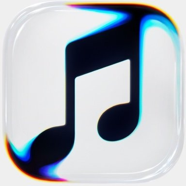

<p align="center">
  
</p>

<h1 align="center">apple music</h1>

<p align="center">
  Web client for streaming full-length audio with word-synchronized lyrics and motion artwork.
  <br />
  <a href="https://nikhilmeshram2006.github.io/apple-music-clone-for-me-only/">Live Demo</a>
</p>

---

## Overview

A personal web player modeled after Apple Music. Built with React and Vite, with a Python build script that resolves 320 kbps AAC streams, time-aligned lyrics from LRCLIB, and H.264 motion album covers.

### Features

- **Audio** — Full-length 320 kbps AAC playback with MediaSession API support and keyboard shortcuts.
- **Lyrics** — word-by-word fill, syllable weighting across Latin,CJK,Devanagari scripts, and click-to-seek lines.
- **Visuals** — Canvas mesh backgrounds sampled from cover art and looping motion artwork where available.
- **Catalog** — 218 pre-indexed tracks across Pop, Romance, J-Pop, K-Pop, French, Latin, Rock, Hip-Hop, R&B, and Bollywood, plus live search.
- **Library** — Local persistence for favorites, custom playlists, followed artists, and listening history.
- **Mobile / PWA** — Responsive layout with installable web app manifest.

## Development

```bash
npm install
npm run dev
```

To rebuild the catalog and lyrics index:

```bash
pip install requests pycryptodome rapidfuzz pillow
npm run catalog
```

## Production Build

```bash
npm run build
```

Static output is written to `docs/` for GitHub Pages deployment.

## License

For personal use.
